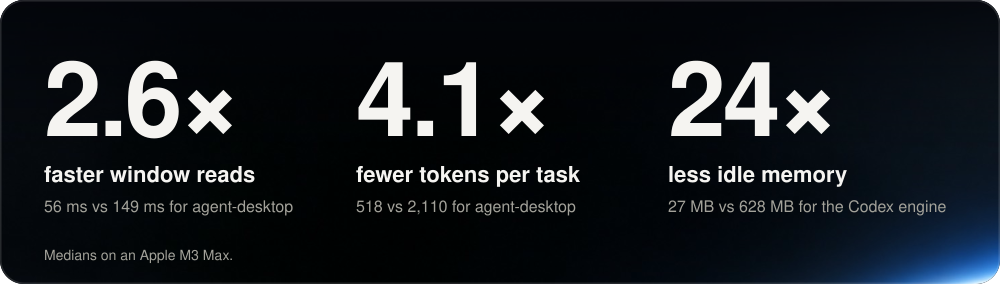
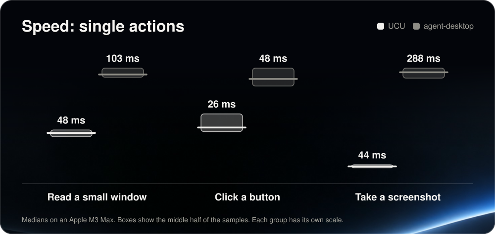
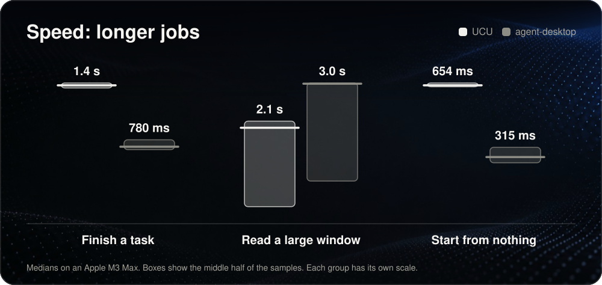
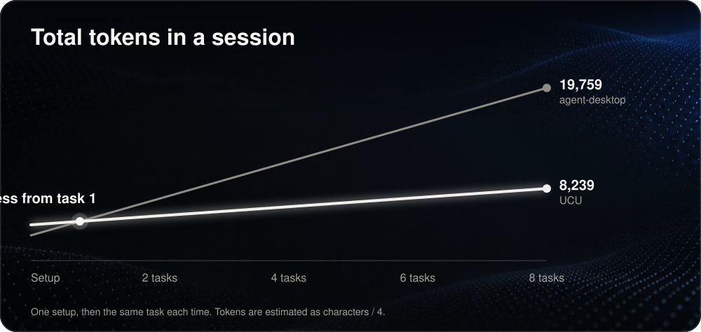

<div align="center">
  <picture>
    <source media="(prefers-color-scheme: dark)" srcset="assets/brand/ucu-logo-dark.svg">
    
  </picture>

  <h3>Universal Computer Use</h3>
  <p><strong>Let your AI agents use your Mac's apps in the background, without touching your mouse or getting in your way.</strong></p>
  <p>Fast, light on tokens, and ready for Claude Code, opencode and any MCP client. An unofficial bridge to the Computer Use engine in the ChatGPT desktop app.</p>

  <p>
    <a href="LICENSE"></a>
    
    
    
    
  </p>

  <p>
    <a href="#why-ucu">Why UCU</a> ·
    <a href="#how-it-compares">How it compares</a> ·
    <a href="#install">Install</a> ·
    <a href="#choosing-which-apps-agents-can-use">Choosing apps</a> ·
    <a href="#tools">Tools</a> ·
    <a href="#how-it-works">How it works</a> ·
    <a href="#before-you-use-it">Before you use it</a>
  </p>
</div>

<p align="center">
  
</p>

## Why UCU

| Capability | What it gives you |
| --- | --- |
| Works in the background | Agents click, type and read other apps without moving your pointer or taking focus. |
| Stays out of your way | A closed app opens hidden, so nothing appears on your screen, and if an app jumps to the front during an agent's action, your app is put back. |
| Has its own desktop | Apps that need clicks by position run on a private desktop you never see. |
| Shares Safari with you | The `safari` tool works in the agent's own hidden window, so you keep your tabs and your keyboard. |
| Runs side by side | Agents in different chats work at once, and each is told when another is using the same app. |
| Has its own cursors | Each chat gets its own cursor color, so you can tell at a glance who is doing what. |
| Sees every window | Agents are told when an app opens a new window, a sheet or a system dialog, with its text and buttons, and `list_windows` lists every open window. |
| Reaches apps without an accessibility tree | Agents can click by screen position in a background window. Some remote-desktop and canvas apps ignore background input. |
| Light on tokens | A task costs about a quarter of the tokens of agent-desktop, and the model gets compact text and diffs. |
| You choose the apps | Every app is approved except the ones you deny, with one command. |
| Shows who did what | Every approval is logged with the agent and folder that caused it. |
| Light when idle | It stops the engine between uses: 27 MB instead of 628 MB. |
| Picks the right window | `focus_window` chooses which window of an app to act on, without moving it, and `js` calls can name a window, so one turn can cover several. |
| Hears errors | When an app plays the macOS alert sound, the agent is told, at no cost in speed. The engine alone reports success. |
| Stays up to date | A Codex update needs nothing from you: UCU finds the newest engine each time it starts it. |

## How it compares

UCU runs OpenAI's Computer Use engine, so its speed matches the engine on its own. The gap between those two bars
is noise, not a speedup. What UCU adds is everything around the engine: it works
with your agents, stops the engine when idle, shortens what the model has to read, and adds the deny list, the log,
hidden launches, the window tools and the notes about error sounds and new windows.

[agent-desktop](https://github.com/vercel-labs/agent-desktop) from Vercel Labs is a separate, open-source tool
with its own engine. The charts compare UCU with agent-desktop, and the table adds the engine alone. All of it comes from the same Mac
and the same tasks:

<p align="center">
  
</p>

<p align="center">
  
</p>

<p align="center">
  
</p>

**Where UCU wins**

- Reads a small window 2.6 times faster, clicks 1.5 times faster and takes screenshots 5.7 times faster than agent-desktop.
- Uses 4 times fewer tokens on the task, with 2 model round trips, the same as agent-desktop with `batch`, and pulls
  ahead on total tokens from the second task.
- Can click by position in a background window. agent-desktop needs `--headed` for that, which moves your real
  pointer and takes focus.
- Tells the agent when an app plays its error sound or opens another window.
- Opens closed apps hidden. Agents can read them, take screenshots and click their elements without showing them.
- Has a per-app deny list and an approval log, and works as an MCP server.

**Where agent-desktop wins**

- Finishes the task faster: 822 ms against 1.4 s. A single click is faster with UCU, but the engine waits about 450 ms
  before it reads a window after an action.
- Starts more than twice as fast: 349 ms against 785 ms.
- Costs less to set up: 2,882 tokens against 4,707.
- Gives a quick outline of a large window in 232 ms, then lets the agent drill in. UCU reads the whole window.
- Is fully open source, runs on Windows and Linux too, and uses less memory when idle (15 MB against 27 MB).
- Reports if each action was delivered and if a retry is safe, and rejects stale element references.

| Test (median) | UCU | Codex engine alone | agent-desktop |
| --- | ---: | ---: | ---: |
| Read a small window | 56 ms | 85 ms | 149 ms |
| Click a button | 59 ms | 58 ms | 88 ms |
| Take a screenshot | 53 ms | 59 ms | 299 ms |
| Finish a task | 1.4 s | 1.4 s | 822 ms |
| Read a large window | 2.1 s | 2.1 s | 3.1 s (outline only: 232 ms) |
| Start from nothing | 785 ms | 632 ms | 349 ms |
| Tokens for the task | 518 | 552 | 2,110 |
| Tokens to read a small window | 390 | 390 | 1,093 |
| Tokens to read a large window | 1,647 | 1,647 | 2,113 (outline only: 1,112) |
| Tokens to set up a session | 4,707 | 6,356 | 2,882 |
| Memory while idle | 27 MB | 628 MB | 15 MB |

<details>
<summary>How this was measured</summary>

Run on one Apple M3 Max with macOS 27.2, the Codex plugin 26.1027.30824 and agent-desktop 1.0.2, so your numbers
will differ. These are this project's own benchmarks, and the script is in the repo so you can check them:

```bash
python3 -I benchmarks/run.py --agent-desktop /path/to/agent-desktop
python3 -I benchmarks/chart.py
```

- The small window is Calculator and the large one is Font Book. The task is pressing `12 + 34 =` and reading the
  answer, starting from a cleared display and seeing the buttons.
- The tools take turns sample by sample, for 3 rounds. Each number is a median of up to 30 samples. Reads of large
  windows varied the most between runs.
- The clock covers the tool only, not the model's thinking time. agent-desktop runs through its CLI, as an agent
  would use it, with `-i --compact` and `batch`, the options its docs recommend to save tokens.
- Tokens are estimated as characters / 4, and count what the model reads and writes. Screenshots aren't counted.
- In the speed charts, each box holds the middle half of the samples, and each group has its own scale. The token
  chart counts one setup, then the same task each time. Chart backgrounds are generated art and carry no data.
- Setup counts tool definitions, the usage rules and the first-use docs for UCU and the engine, and the two
  `skills get` guides for agent-desktop. Tool definitions go with every request, usually from a cache.
- UCU's setup is smaller because it leaves the browser part out of the docs and the tool list until a call needs it,
  drops two tools agents don't use, and replaces the engine's confirmations policy with a short summary. The summary
  only applies to the policy version it was written from. If an update changes that policy, the full text goes through.
  It also shortens the sentences the engine repeats on each state, which is the small saving on the task.
- Idle memory leaves out the Computer Use service itself, which UCU and the engine share. UCU stops the
  engine 2 minutes after a turn ends.

</details>

## Before you use it

- **This is an unofficial project.** It is not made by, affiliated with, or endorsed by OpenAI or Anthropic.
- **It relies on private parts of the ChatGPT app.** OpenAI doesn't offer them as a public interface, so an
  update can break UCU at any time.
- **OpenAI's terms still apply to you.** UCU runs the engine outside Codex and answers its approval prompt
  for you. Read [OpenAI's Terms of Use](https://openai.com/policies/row-terms-of-use/) and decide whether
  that fits your account. You use it at your own risk.
- **Agents get real access.** Anything an app can do, an agent can do through it. Deny the apps you want to
  keep them out of.
- **The private desktop is a virtual display.** It uses a private macOS feature, and it appears in your display
  settings while an agent needs it.

## Requirements

- macOS, with the Xcode Command Line Tools (`xcode-select --install`)
- Python 3.9 or newer
- [Claude Code](https://claude.com/claude-code), with the `claude` command on your `PATH`
- The ChatGPT desktop app, with Computer Use set up in Codex. Run one Computer Use task there first, so
  macOS grants its permissions.

## Install

```bash
git clone https://github.com/betoxf/universal-computer-use.git
cd universal-computer-use
./ucu install
./ucu doctor
```

UCU runs from this folder, so keep it. Start a new Claude Code session to pick it up; open sessions need a
restart. If `doctor` reports a problem, it says what to do next. Picking app windows needs Accessibility
permission for the app that runs Claude Code, such as Terminal: **System Settings > Privacy & Security >
Accessibility**.

`./ucu install` backs up what it changes to `~/Library/Application Support/ucu/backups/<time>/`, then:

- builds `~/.local/bin/ucu-window`
- writes the approval policy, unless you already have one
- registers the `ucu` server in `~/.claude.json`
- adds a `Stop` hook to `~/.claude/settings.json`, so UCU knows when Claude's turn ends
- registers `ucu` in `~/.config/opencode/opencode.json`, if opencode is set up

If UCU doesn't start, install changes nothing. To run the server with a particular Python, use
`./ucu install --python /path/to/python3`.

To make Claude Code prefer UCU over its built-in computer use, add this to your `~/.claude/CLAUDE.md`:

```markdown
To operate native Mac apps, use the `ucu` MCP server instead of the built-in computer-use tools.
```

## Choosing which apps agents can use

Agents can use every app except the ones you deny. A new install denies password managers, Keychain Access
and System Settings.

```bash
./ucu deny "Mail"      # block an app
./ucu allow "Mail"     # unblock it
./ucu denied           # list the blocked apps
```

Changes apply at the next prompt, with no restart. Names match regardless of case, and a bundle id such as
`com.apple.mail` works too. The list is in `~/Library/Application Support/ucu/policy.json`:

```json
{
  "deny": ["1Password", "Keychain Access", "System Settings"]
}
```

If that file is missing or broken, every app is asked in Claude instead, so a denied app can't slip through.

Each decision goes to `~/Library/Logs/ucu/approve.log`, with the client and folder that caused it:

```
2026-10-31 14:02:11 claude-code:my-project allowed Google Chrome
2026-10-31 14:02:40 opencode:website denied Mail
```

## Tools

- `js {code, timeout_ms?, window?}`: the engine's tool. With `window: {app, title}`, UCU makes that window the
  app's main window first.
- `js_reset`: the engine's own tool.
- `list_windows {app?}`: the windows of an app, or of every app without `app`, which one is the main window, and
  whether each is a dialog, minimized or full screen. `cua.getApp(app)` always acts on the main window.
- `focus_window {app, title, unfullscreen?, activate?}`: makes the window whose title contains `title` the
  main window, so the next `cua.getApp(app)` acts on it. The window stays where it is. With `activate: true`, the app
  also comes to the front, for when you should see it.
- `move_to_desktop {app}`: moves an app's windows to the agent's private desktop.
- `safari {op, ...}`: works in Safari in the agent's own window.

In a `js` call, wait for a window to react instead of sleeping:

```js
const { waitForChange } = await import("<this folder>/js/wait.mjs");
const r = await waitForChange(app, () => app.click(8), { timeoutMs: 20000 }); // { changed, settled, ms, changedBlocks }
```

When an app rejects an input it plays the macOS alert sound, which a person hears but an agent can't. UCU watches
the system sound server's log and adds a note to a `js` result:

```
[ucu: Calculator played an alert sound during your last actions, which usually means it rejected an input. Check the app before going on.]
```

Nothing waits for a sound, so this adds no time to a call. The note comes with the same result if a read follows the
action in that call, and with the next result if not. It needs no permission, hears no audio, and only reports apps
that chat is driving.

New windows work the same way. While a call runs, and for a moment after, UCU compares the windows of the apps that
chat drives and looks for system dialogs such as password prompts:

```
[ucu: Safari opened a dialog titled "Sign in". Its text: "Enter your password". Buttons: "Cancel", "OK". To act on it, call focus_window with its title, then cua.getApp.]
```

The server sends the usage rules in its MCP `instructions`, so clients get them without their own config.

### Staying out of your way

When an agent calls `cua.getApp` on a closed app, UCU opens it hidden first. Its Dock icon shows it is running, and
nothing appears on screen unless you click that icon or the agent calls `focus_window` with `activate: true`. Apps
that show themselves anyway, such as Blender, are hidden as soon as their window appears, behind your front app. A
denied app stays closed.

The agent reads a hidden app, takes screenshots of it and clicks its elements as usual. Two things need a window on
screen: input by coordinates, and a few actions that an app refuses while hidden, such as opening its settings. For
those, UCU moves the app to the agent's private desktop. Agents that open an app with the `open` command skip all of
this, so the usage rules tell them not to.

If an app comes to the front during an agent's call or just after it, and it is an app that chat drives or one that
just started, UCU puts your app back and tells the agent. If you pressed a key or clicked just before, it does nothing,
because you may have switched apps yourself.

### The private desktop

Each chat that needs one gets a virtual display, called UCU Agent Desktop, 1920 by 1200. macOS treats its windows as
on screen, so they keep rendering and take clicks by position, but nobody sees them, and the agent's cursor stays
there too. The display touches your screens at one corner at most, so your pointer won't wander onto it. It appears
in System Settings > Displays while it exists.

UCU creates it on first use and removes it 2 minutes after a turn ends, or when the chat closes. The apps on it are
hidden first, and macOS puts their windows back where they were. If you click such an app in the Dock, its windows come
back to your screen. When an agent calls `focus_window` with `activate: true`, they do too.

Virtual displays are a private macOS feature. If they are not available, apps are shown behind your windows instead.

### Safari

The engine can only act on an app's main window, and in Safari that is the window you are working in. So agents use
the `safari` tool, and UCU tells them to if they call `cua.getApp("Safari")` while you are in it:

- `list` shows every window and tab, yours too.
- `open` loads a page in a new tab of the agent's own hidden window. Each chat has its own, closed when the chat ends.
- `navigate`, `read`, `click`, `type`, `wait` and `eval` work in those tabs while the window stays hidden.
- `shot` takes a screenshot. Safari stops painting hidden windows, so the window moves to the private desktop until
  the turn ends. Your window keeps the keyboard.
- Changing one of your tabs needs `allow_user_tab`, and the tab you are viewing also needs `allow_current_tab`.
  Agents are told to use those only if you asked.

It needs **Safari > Settings > Advanced > Show features for web developers**, then **Develop > Allow JavaScript from
Apple Events**, and permission for the app running Claude Code to control Safari. `shot` also needs Screen Recording
for that app. The first window can flash for a moment when it is created. Clicks and typing are synthetic, so file
pickers and some logins ignore them.

### Several windows and several agents

One `js` call can drive several apps. To work on several windows of one app in a turn, an agent sends one `js` call
for each with `window: {app, title}`, and UCU runs them one at a time.

Agents in different chats can work at the same time on different apps, with no slowdown you'd notice. Each chat keeps a
small file in `~/Library/Application Support/ucu/sessions/`, and when an agent gets an app another agent used in the
last 3 minutes, it gets a note saying who. Two agents on the same window still undo each other's work, so the note asks
it to wait or ask you. In Safari, each chat has its own window, so they don't collide.

### Cursors

Each chat has its own cursor in place of the engine's: the same shape and soft shadow, in a color no other chat is using.
A chat in the same folder gets the same color when it is free, and the color goes in the chat's session file. The cursor
takes a curved path to each new spot, leans into the move, stays just above the window it is working on, and fades out
when the turn ends. It takes no clicks and never moves your pointer.

The engine has no setting for its cursor, so `ucu-window watch` follows the engine's cursor windows and hides the engine's
service, which needs Accessibility permission. The engine's own cursor can show for about a frame each time it moves.
Without that permission you see both cursors. Chats that were already open keep the engine's cursor until they restart.
An agent working on a hidden app or on the private desktop shows no cursor on your screen at all.

### When something goes wrong

The engine's errors are short, so UCU explains the common ones where they happen: a key name it doesn't know, a stale
element number, an app that didn't answer, an app that isn't approved. If a running app has no window, UCU opens one
hidden instead of letting the call fail.

## Other MCP clients

Any client that speaks MCP over stdio can run the server directly:

```json
{
  "command": "python3",
  "args": ["-I", "/path/to/universal-computer-use/scripts/ucu-proxy.py"]
}
```

Without the `Stop` hook, a turn ends after 2 minutes without a call.

## Update

```bash
git pull
./ucu install
```

Then start a new session.

## Uninstall

```bash
./ucu uninstall
```

This removes the server, hook and `ucu-window`. Your policy, logs and backups stay in
`~/Library/Application Support/ucu/` and `~/Library/Logs/ucu/`. Delete those and this folder to remove
everything.

## How it works

| Path | What it does |
| --- | --- |
| `ucu` | The `install`, `uninstall`, `doctor`, `deny`, `allow` and `denied` commands. |
| `scripts/ucu-proxy.py` | The MCP server: a stdio proxy that runs the engine as the newest usable Codex plugin defines it, answers app approvals from the policy, adds the window tools and usage rules, ends turns, stops and restarts the engine when idle, and shortens what the model reads. |
| `native/ucu-window.swift` | `ucu-window list/focus`, behind the `list_windows` and `focus_window` tools, and `ucu-window watch`, which opens apps hidden, reports new windows, holds the private desktop and draws each chat's cursor. |
| `native/safari.js` | The Safari side of the `safari` tool, run with `osascript`. |
| `js/wait.mjs` | `waitForChange()`, which waits for a window to change and settle. |

## Tests

```bash
python3 -m unittest discover -s tests
```

These run the real proxy and installer against a fake engine in a temporary `HOME`, with fake `claude` and
`swiftc`. `python3 -I tests/smoke_live.py` starts the proxy against your installed Codex plugin and takes one
screenshot of Calculator instead. `benchmarks/` holds the benchmark behind the charts on this page.

## Credits and trademarks

This repo contains no OpenAI code. The engine stays in your own ChatGPT install, under OpenAI's terms.

The approval log's agent names, the warning before repeating a call after a crash, and sending usage rules
from the server were inspired by [agent-desktop](https://github.com/vercel-labs/agent-desktop) from Vercel
Labs (Apache-2.0). No code was copied. If you need an open-source engine or Windows and Linux support, take a
look at it.

OpenAI, ChatGPT and Codex are trademarks of OpenAI. Claude is a trademark of Anthropic. They are named here
only to say what this project works with.

## License

[Apache-2.0](LICENSE). Copyright 2026 Humberto Prado.
